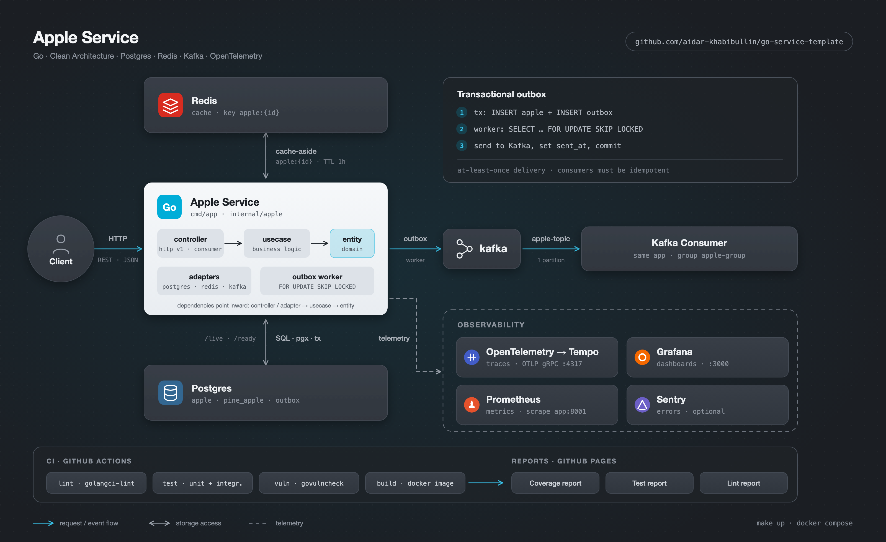

# go-service-template


[](https://github.com/aidar-khabibullin/go-service-template/actions/workflows/ci.yml)

📊 **Отчёты о качестве кода** (обновляются на каждый push в `main`):
- 📊 [Coverage Report](https://aidar-khabibullin.github.io/go-service-template/coverage/) — покрытие бизнес-логики (`internal/`) тестами
- 🧪 [Test Report](https://aidar-khabibullin.github.io/go-service-template/tests/) — результаты unit и интеграционных тестов
- 🔍 [Lint Report](https://aidar-khabibullin.github.io/go-service-template/lint/) — результаты golangci-lint

> Покрытие считается только для `internal/`, без fakes (`usecasetest`), test-хелперов (`itest`) и `cmd/`.
> Бейдж Coverage обновляется автоматически job-ом `reports` в CI.



Шаблон Go-сервиса: Clean Architecture, Postgres, Redis, Kafka, OpenTelemetry.

## Архитектура

```
cmd/app            точка входа
config             конфигурация из env (.env необязателен)
internal/app       сборка зависимостей, graceful shutdown
internal/apple
  entity           доменные модели и правила (без зависимостей от инфраструктуры)
  dto              входные/выходные структуры use case-ов
  usecase          бизнес-логика; зависит только от интерфейсов (usecase.go)
  usecase/usecasetest  in-memory фейки для тестов
  adapter          postgres, redis, kafka_producer — реализации интерфейсов
  controller       http_router (v1), kafka_consumer, worker (outbox)
pkg                переиспользуемые обёртки (postgres, redis, transaction, otel, ...)
migration          SQL-миграции (golang-migrate)
```

Зависимости направлены внутрь: `controller/adapter → usecase → entity`.

## Как это работает

- **Транзакции.** `pkg/transaction.Manager.Do(ctx, fn)` кладёт `pgx.Tx` в `ctx`; адаптеры берут её через
  `transaction.GetExecutor`. Ошибка или panic в `fn` — rollback.
- **Transactional outbox.** `CreateApple` пишет яблоко и событие в таблицу `outbox` одной транзакцией.
  `worker.OutboxWorker` отправляет события в Kafka (`FOR UPDATE SKIP LOCKED`, доставка *at-least-once*,
  потребители должны быть идемпотентными).
- **Cache-aside.** `GetApple`: Redis → при промахе Postgres → заполнение кеша. Если Redis недоступен, запрос
  всё равно обслуживается из Postgres. `Update`/`Delete` инвалидируют кеш.
- **Удаление мягкое** (`deleted_at`).
- **Graceful shutdown.** По SIGINT/SIGTERM: останавливается HTTP-сервер (доработка текущих запросов),
  затем воркеры и consumer, и только после этого закрываются адаптеры.
- **Probes.** `/live` — процесс жив; `/ready` — проверяет Postgres и Redis.

## HTTP API

| Метод  | Путь                                 | Описание                                   |
|--------|--------------------------------------|--------------------------------------------|
| POST   | `/api/apple/v1/create_apple`         | `{"name": "..."}` → `{"id": "..."}`        |
| POST   | `/api/apple/v1/create_pineapple`     | `{"name": "..."}` — яблоко + ананас в одной транзакции |
| GET    | `/api/apple/v1/get_apple/{id}`       | получить яблоко                            |
| PUT    | `/api/apple/v1/update_apple/{id}`    | `{"name": "...", "status": "new\|success\|error"}` → 204 |
| DELETE | `/api/apple/v1/delete_apple/{id}`    | → 204                                      |

Тело запроса ограничено 1 МиБ, неизвестные поля отклоняются (400).

## Запуск

```bash
cp .env.example .env
make up          # весь стек: app, postgres, migrate, redis, kafka, tempo, grafana, ...
make down
```

Миграции применяются автоматически сервисом `migrate` в docker compose. Вручную: `make migrate-up`.

Локально без Docker для приложения: `make run` (нужны запущенные postgres/redis/kafka).

## Разработка

```bash
make test               # unit-тесты (-race)
make test-integration   # + Postgres/Redis в testcontainers (нужен Docker)
make lint               # golangci-lint v2
make vuln               # govulncheck
make mod-update         # обновить зависимости
```

CI (`.github/workflows/ci.yml`): lint, unit + integration тесты, govulncheck, сборка Docker-образа.
Job `reports` собирает HTML-отчёты (`.github/scripts/build_reports.py`) и публикует их на GitHub Pages.
Одноразовая настройка: *Settings → Pages → Source: GitHub Actions*.
